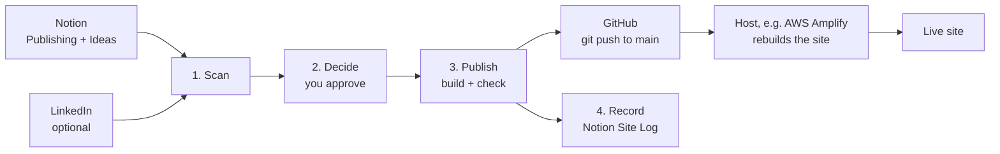

# notion-to-astro-pipeline

Write in Notion. Tell Claude "sync my site". Your personal website updates.

This repo is two things:

1. **A personal website**: About and résumé, Projects, and a Blog. Built with [Astro](https://astro.build). Static, fast, and free to host.
2. **A publishing pipeline run by [Claude Code](https://claude.com/claude-code)**: Claude reads your Notion, checks what is ready, shows you the changes, builds the site, and pushes it live after you say yes. It can also keep your résumé in step with LinkedIn.

You do not write code. You write in Notion and approve changes in plain English.

---

## How it works



| Stage | What Claude does |
|-------|------------------|
| Scan | Reads `Ready` entries, scans your Ideas Library, and (optionally) compares LinkedIn with your résumé. |
| Decide | Shows one summary and asks about each real choice. Nothing changes without your yes. |
| Publish | Writes the page, runs the build, previews it, reviews the diff, then commits and pushes. |
| Record | Marks the Notion entry `Published` and adds a dated entry to the Site Log. |

Guardrails built in:
- Entries ticked **Confidential** never publish.
- Words you list as **sensitive terms** (an employer name, internal project names) are flagged and removed from essays.
- Claude never signs in for you and never types passwords.
- Every new chat starts by reading the Site Log, so Claude continues where it stopped.

---

## What you need

- A Mac, Windows or Linux computer with [Node.js 20+](https://nodejs.org) and [Git](https://git-scm.com).
- [Claude Code](https://claude.com/claude-code) (the desktop app's Code tab or the CLI), with the **Notion** connector added.
- A free [GitHub](https://github.com) account.
- A host that deploys from GitHub. The steps below use **AWS Amplify**. Netlify, Vercel and Cloudflare Pages also work.

---

## Setup (about 30 minutes, once)

### 1. Get your own copy
Click **Use this template** on GitHub (or fork it) and make a **private** repo. Then clone it:
```bash
git clone https://github.com/<you>/<your-repo>.git my-site
cd my-site
npm install
```

### 2. Set up Notion
Follow [NOTION-SETUP.md](NOTION-SETUP.md). You duplicate one template page and connect Notion to Claude.

### 3. Let Claude configure the pipeline
Open the `my-site` folder in Claude Code and say:

> Set up my pipeline.

Claude finds your Notion databases, writes their IDs to `pipeline.config.json`, and asks for your live URL, LinkedIn URL (optional) and sensitive terms.

### 4. Add your details
Ask Claude to put your name, bio and résumé in, or edit these files yourself:

| To change | Edit |
|-----------|------|
| Name, site description | `src/site.ts` |
| Bio, résumé, skills, links | `src/pages/index.astro` |
| Projects | `src/pages/projects.astro` |
| Colours and fonts | `src/styles/global.css` (see [DESIGN.md](DESIGN.md)) |

Preview it with `npm run dev` and open http://localhost:4321.

### 5. Put it online (AWS Amplify)
Follow [AMPLIFY-SETUP.md](AMPLIFY-SETUP.md). In short:
1. Push your repo to GitHub.
2. In the [Amplify console](https://console.aws.amazon.com/amplify), choose **Create new app**, pick **GitHub**, then your repo and `main`.
3. Amplify reads the included `amplify.yml`. Choose **Save and deploy**.
4. Tell Claude your live URL. Optional: add your own domain.

From now on, each push to `main` republishes the site.

---

## Everyday use

| You want to | Say to Claude |
|-------------|---------------|
| Publish what is ready | "Sync my site." |
| See what is in the pipeline | Start a new chat. Claude reports automatically. |
| Turn an idea into a draft | "Draft the <idea title> essay." Claude creates a `Refining` entry and a hidden draft post. |
| Update your résumé from LinkedIn | "Check LinkedIn for changes." Sign in when asked. |

---

## What is in the repo

| Path | What it is |
|------|------------|
| `src/` | The Astro site |
| `.claude/skills/website-content-sync/SKILL.md` | The pipeline: Scan → Decide → Publish → Record |
| `CLAUDE.md` | Project rules Claude follows in every chat |
| `.claude/hooks/` and `.claude/settings.json` | Two reminder hooks: run the check at each new chat, and log any change to the pipeline |
| `pipeline.config.json` | Your Notion IDs, URLs and sensitive terms |
| `.claude/launch.json` | Lets Claude start the local preview |
| `NOTION-SETUP.md` | Notion template and database schema |
| `AMPLIFY-SETUP.md` | Step-by-step hosting setup in the AWS console |

The hooks need `jq`. macOS includes it. On Linux, install it with your package manager. On Windows, use WSL or Git Bash with `jq` installed.

---

## Cost

- Hosting a personal site on Amplify's free tier is typically $0 a month at normal traffic.
- A custom domain is about $12 a year.
- Claude Code needs a Claude plan that includes it.

## License

MIT. See [LICENSE](LICENSE).
